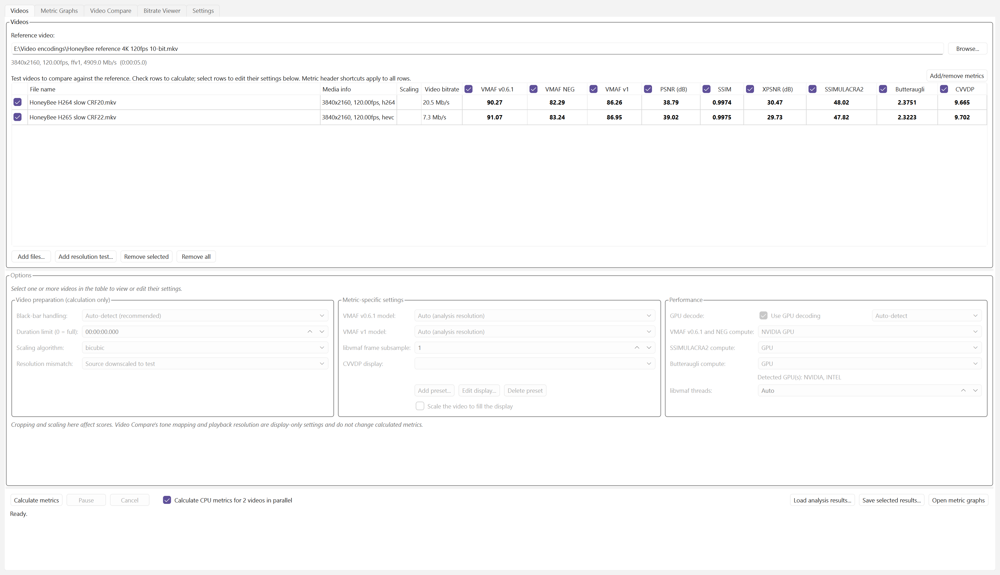
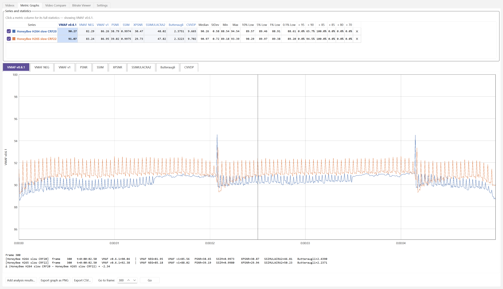
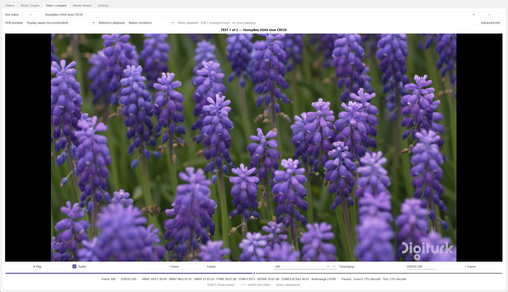
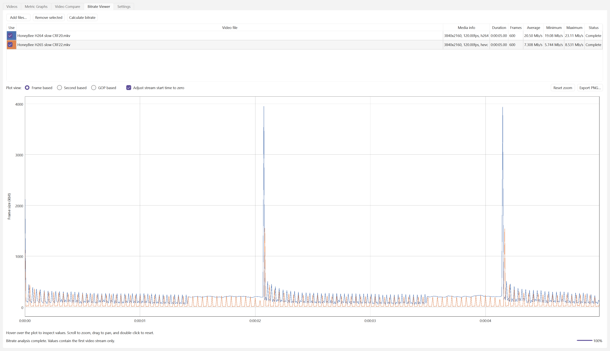

# VideoMetricsLab

Calculate VMAF, VMAF NEG, VMAF v1, SSIMULACRA2, Butteraugli and ColorVideo VDP on NVIDIA, AMD, Intel and Apple GPUs, alongside PSNR, SSIM and XPSNR. Compare encodes with frame-exact playback that switches between the source and each encode instantly to easily spot differences.

New in v2.2.1: VideoMetricsLab now runs on macOS (Apple silicon), and SSIMULACRA2, Butteraugli and ColorVideo VDP use [Vship-fast](https://github.com/4KVCD/Vship-fast): Butteraugli **1.75x-2.5x**, ColorVideo VDP **1.6x-2.4x** and SSIMULACRA2 up to **1.6x** faster, and as accurate as libjxl and pycvvdp. See the [changelog](CHANGELOG.md).

## Features

**Metrics**
- VMAF v0.6.1, VMAF NEG, VMAF v1, PSNR, SSIM, XPSNR, SSIMULACRA2, Butteraugli and ColorVideo VDP, for many test videos at once.
- VMAF models for standard, phone, 4K and HFR viewing.

**Fast on any GPU**
- VMAF, VMAF NEG and VMAF v1 on NVIDIA, AMD, Intel and Apple GPUs with [libvmaf-fast](https://github.com/4KVCD/libvmaf-fast): VMAF v1 up to **17x** faster.
- SSIMULACRA2, Butteraugli and ColorVideo VDP on any GPU with [Vship-fast](https://github.com/4KVCD/Vship-fast) (Vulkan); libjxl on the CPU when no GPU can be used, for SSIMULACRA2 and Butteraugli.
- PSNR, SSIM and XPSNR **2.7x-11x** faster, calculated in the app.
- GPU video decoding, with software decoding for formats the GPU can't handle, such as VVC.

**Compare and inspect**
- Frame-exact playback that switches instantly between the source and each encode (hold **S**), with zoom, at up to 120 fps in 4K HDR.
- Metric curves, statistics and per-frame scores (per second for ColorVideo VDP), with each metric's best and worst results highlighted.
- Bitrate by frame, second or GOP.

**Workflow**
- Black bars and resolution mismatches handled automatically.
- Results saved and reloaded automatically.
- Drag and drop videos, sort and reorder the list, and a dark theme.
- A command line, `VideoMetricsLab-cli`, for scripts.
- Two test videos calculated in parallel on many-core CPUs.

## Videos

Configure each test independently, inspect its codec and bitrate, and calculate
multiple quality metrics in one run.



## Metric graphs

Compare real per-frame curves and distribution statistics. The frame readout
shows both test values and their signed delta at the same moment.



## Video Compare

Switch instantly between the reference and test encodes during playback, or
seek to an exact frame for close inspection.



## Bitrate Viewer

Analyze video-only bitrate independently by frame, second, or GOP.



## Quick start

1. Select a reference video.
2. Add one or more test videos.
3. Choose the metrics to calculate.
4. Click **Calculate metrics**.

Results appear in the video table and Metric Graphs tab as each test finishes.
Video Compare and Bitrate Viewer can also be used without calculating metrics.

For detailed instructions, see the [User Guide](docs/USER_GUIDE.md).

## Install

### Packaged release

Download the Windows or macOS zip from the [latest release](https://github.com/4KVCD/VideoMetricsLab/releases/latest),
extract it, and run `VideoMetricsLab.exe` (Windows) or `VideoMetricsLab.app`
(macOS). The macOS app is not notarized: the first time, open it from System
Settings > Privacy & Security > Open Anyway.

The app requires **FFmpeg 9 or newer with libvmaf**. FFmpeg is not bundled; the
app prompts for its location if it is not available on `PATH`. On macOS,
`brew install ffmpeg` installs it.

### Build from source

Requires Visual Studio 2022, CMake 3.25+, Qt 6.12 and MinGW-w64; see the
[contributing guide](CONTRIBUTING.md):

```powershell
./scripts/build_release.ps1 -QtPath C:\Qt\6.12.0\msvc2022_64
```

## Requirements

- Windows 10 or 11, or macOS 14.4 or later on Apple silicon
- FFmpeg 9+ with `ffmpeg`, `ffprobe`, and `libvmaf`
- On Windows, an optional NVIDIA, Intel, or AMD GPU for hardware decoding and
  the GPU metrics

## Development

```powershell
cd cpp
cmake --preset windows -DCMAKE_PREFIX_PATH=C:/Qt/6.12.0/msvc2022_64
cmake --build --preset windows-release
ctest --preset windows-release
```

Build the distributable with `./scripts/build_release.ps1`. See the
[build guide](docs/BUILD.md) and [contributing guide](CONTRIBUTING.md) for more.

## Documentation

[User Guide](docs/USER_GUIDE.md) ·
[Troubleshooting](docs/TROUBLESHOOTING.md) ·
[Known Issues](docs/KNOWN_ISSUES.md) ·
[Architecture](docs/ARCHITECTURE.md) ·
[Changelog](CHANGELOG.md) ·
[Security](SECURITY.md)

## License

Licensed under the [MIT License](LICENSE). Copyright (c) 2026 **4KVCD**.
Third-party components retain their own licenses; see
[Third-Party Notices](docs/THIRD_PARTY.md).

### ❤️ Enjoying VideoMetricsLab?

If VideoMetricsLab has been useful to you, I'd love to hear from you!

[💬 Leave a comment / say thanks](https://github.com/4KVCD/VideoMetricsLab/discussions)

You can also ⭐ star the repository — it helps me know people are finding the project useful.

## Changelog

See the [changelog](CHANGELOG.md) for what changed in each version.
