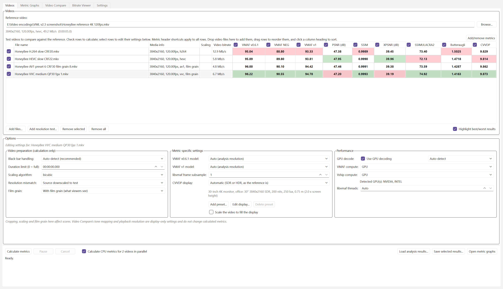
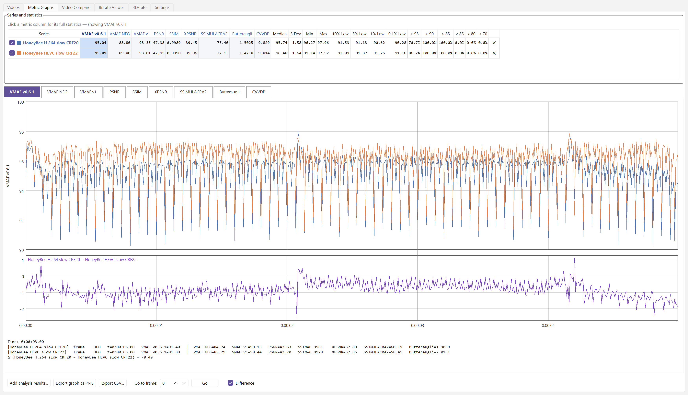
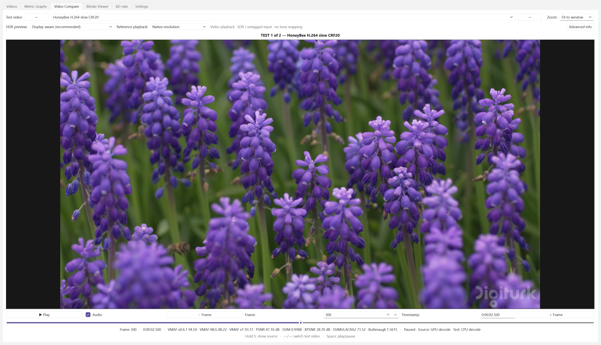
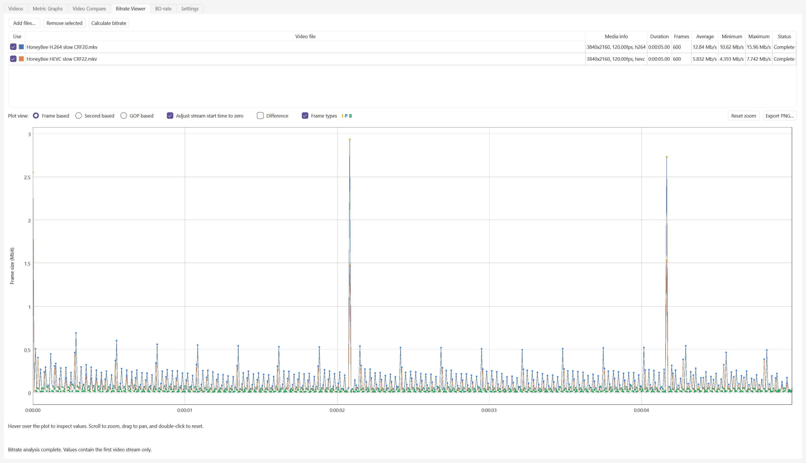
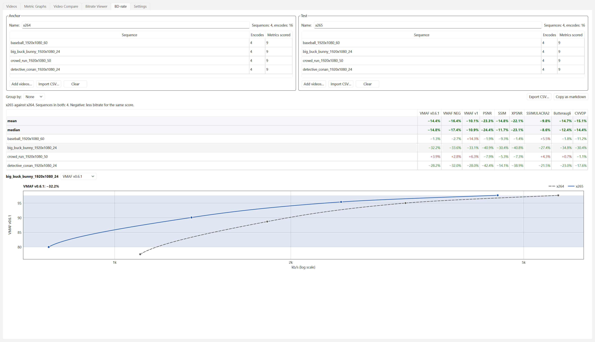

# VideoMetricsLab

Calculate VMAF, VMAF NEG, VMAF v1, SSIMULACRA2, Butteraugli and ColorVideo VDP on NVIDIA, AMD, Intel and Apple GPUs, alongside PSNR, SSIM and XPSNR. Compare encodes with frame-exact playback that switches between the source and each encode instantly to easily spot differences.

VideoMetricsLab v2.4 adds an experimental GPU VVC decoder, BD-rate calculation, instant metric scores for any time range for a video that's already been scored, a difference graph for 2 videos' scores and bitrate and improves resolution test speed up to 27x, along with various bug fixes. See the [changelog](CHANGELOG.md).

## Features

**Metrics**
- VMAF v0.6.1, VMAF NEG, VMAF v1, PSNR, SSIM, XPSNR, SSIMULACRA2, Butteraugli and ColorVideo VDP, for many test videos at once.
- VMAF models for standard, phone, 4K and HFR viewing.
- ColorVideo VDP scored for the display you choose, or automatically HDR or SDR to match the video.
- Film grain scored as viewers see it, or without it: VVC, AV1 and AFGS1 grain, at any bit depth.
- Resolution tests: how a video scores scaled down and back up, at any size, with your choice of scaling algorithm.

**Fast on any GPU**
- VMAF, VMAF NEG and VMAF v1 on NVIDIA, AMD, Intel and Apple GPUs with [libvmaf-fast](https://github.com/4KVCD/libvmaf-fast): VMAF and VMAF NEG **3.2x-4.4x** faster than with CUDA on NVIDIA, up to **28x** faster than on a 24-core CPU, and VMAF v1 up to **17x** faster.
- SSIMULACRA2, Butteraugli and ColorVideo VDP on any GPU with [Vship-fast](https://github.com/4KVCD/Vship-fast) (Vulkan), as accurate as libjxl and pycvvdp, and faster than Vship's Vulkan build: Butteraugli **1.75x-2.5x**, ColorVideo VDP **1.6x-2.4x** and SSIMULACRA2 up to **1.6x**.
- Stock Vship for any video you choose or when Vship-fast fails, on Vulkan, HIP (AMD) or CUDA (NVIDIA), and libjxl on the CPU calculates SSIMULACRA2 and Butteraugli when no GPU can.
- PSNR, SSIM and XPSNR **2.7x-11x** faster than with FFmpeg, calculated in the app.
- Resolution tests up to **27x** faster than with FFmpeg's libvmaf on the CPU.
- GPU video decoding, with software decoding for the rest: VVC with Fraunhofer's VVdeC, **1.4x-2.3x** faster than FFmpeg's VVC decoder, AV2 with VideoLAN's dav2d, and an experimental GPU VVC decoder on Windows.

**Compare and inspect**
- Frame-exact playback that switches instantly between the source and each encode (hold **S**), with zoom, at up to 120 fps in 4K HDR, in HDR on an HDR display, with film grain shown as it is scored and the soundtrack, up to 7.1.
- Metric curves, statistics and per-frame scores (per second for ColorVideo VDP), with each metric's best and worst results highlighted.
- Bitrate by frame, second or GOP, with each frame's type (I, P or B).
- A difference graph for 2 videos' scores and bitrate.
- BD-rate calculation: how much bitrate one encoder saves over another at the same quality.

**Workflow**
- Black bars found the way HandBrake finds them, and resolution mismatches handled automatically.
- Results saved and reloaded automatically; a metric added later is the only one calculated.
- Metric scores for any time range of a video, instantly if the video has already been scored.
- Scores and statistics exported as CSV or JSON.
- Drag and drop videos, sort and reorder the list, and a dark theme, in 20 languages.
- Raw video files such as .266 open directly, with their frame rate read from the stream.
- A command line, `VideoMetricsLab-cli`, for scripts: comparisons, bitrate and BD-rate. It also reads raw video streams and .yuv files.
- Two test videos calculated in parallel on many-core CPUs.
- A native C++ app: a 48 MB download on Windows.

## Videos

Configure each test independently, inspect its codec and bitrate, and calculate
multiple quality metrics in one run.



## Metric graphs

Compare real per-frame curves and distribution statistics. The frame readout
shows both test values and their signed delta at the same moment.



## Video Compare

Switch instantly between the reference and test encodes during playback, or
seek to an exact frame for close inspection.



## Bitrate Viewer

Analyze video-only bitrate independently by frame, second, or GOP.



## BD-rate

See how much bitrate one encoder saves over another at the same quality, for every metric, from videos you
have scored or a CSV file.



## Quick start

1. Select a reference video.
2. Add one or more test videos.
3. Choose the metrics to calculate.
4. Click **Calculate metrics**.

Results appear in the video table and Metric Graphs tab as each test finishes.
Video Compare and Bitrate Viewer can also be used without calculating metrics.

For detailed instructions, see the [User Guide](docs/USER_GUIDE.md).

## Install

### Packaged release

Download the Windows or macOS zip from the [latest release](https://github.com/4KVCD/VideoMetricsLab/releases/latest),
extract it, and run `VideoMetricsLab.exe` (Windows) or `VideoMetricsLab.app`
(macOS). The macOS app is not notarized: the first time, open it from System
Settings > Privacy & Security > Open Anyway.

The app requires **FFmpeg 9 or newer with libvmaf**. FFmpeg is not bundled; the
app prompts for its location if it is not available on `PATH`. On macOS,
`brew install ffmpeg-full` installs it (with zscale, which HDR video needs to be shown in SDR).

### Build from source

Requires Visual Studio 2022, CMake 3.25+, Qt 6.12 and MinGW-w64; see the
[contributing guide](CONTRIBUTING.md):

```powershell
./scripts/build_release.ps1 -QtPath C:\Qt\6.12.0\msvc2022_64
```

## Requirements

- Windows 10 or 11, or macOS 14.4 or later on Apple silicon
- FFmpeg 9+ with `ffmpeg`, `ffprobe`, and `libvmaf`
- On Windows, an optional NVIDIA, Intel, or AMD GPU for hardware decoding and
  the GPU metrics

## Development

```powershell
cd cpp
cmake --preset windows -DCMAKE_PREFIX_PATH=C:/Qt/6.12.0/msvc2022_64
cmake --build --preset windows-release
ctest --preset windows-release
```

Build the distributable with `./scripts/build_release.ps1`. See the
[build guide](docs/BUILD.md) and [contributing guide](CONTRIBUTING.md) for more.

## Documentation

[User Guide](docs/USER_GUIDE.md) ·
[Troubleshooting](docs/TROUBLESHOOTING.md) ·
[Known Issues](docs/KNOWN_ISSUES.md) ·
[Architecture](docs/ARCHITECTURE.md) ·
[Changelog](CHANGELOG.md) ·
[Security](SECURITY.md)

## License

Licensed under the [MIT License](LICENSE). Copyright (c) 2026 **4KVCD**.
Third-party components retain their own licenses; see
[Third-Party Notices](docs/THIRD_PARTY.md).

### ❤️ Enjoying VideoMetricsLab?

If VideoMetricsLab has been useful to you, I'd love to hear from you!

[💬 Leave a comment / say thanks](https://github.com/4KVCD/VideoMetricsLab/discussions)

You can also ⭐ star the repository — it helps me know people are finding the project useful.

## Changelog

See the [changelog](CHANGELOG.md) for what changed in each version.
